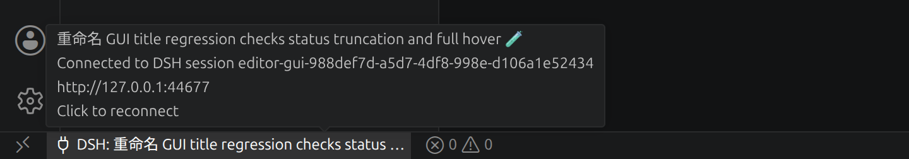
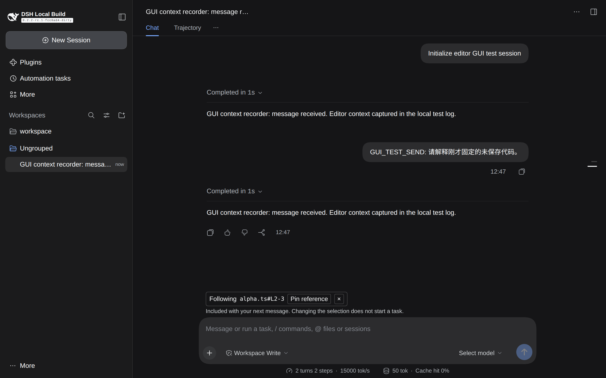
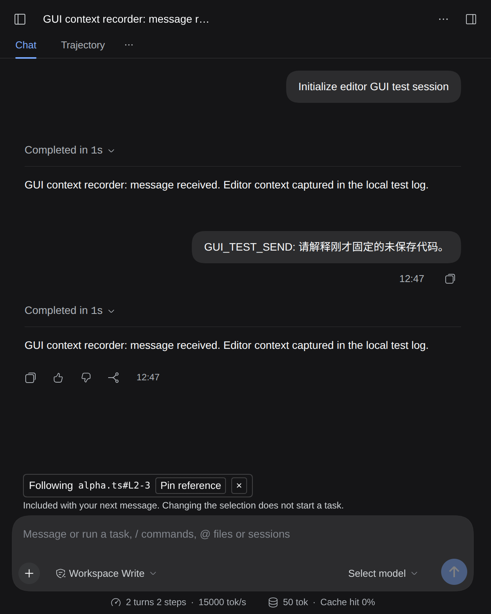
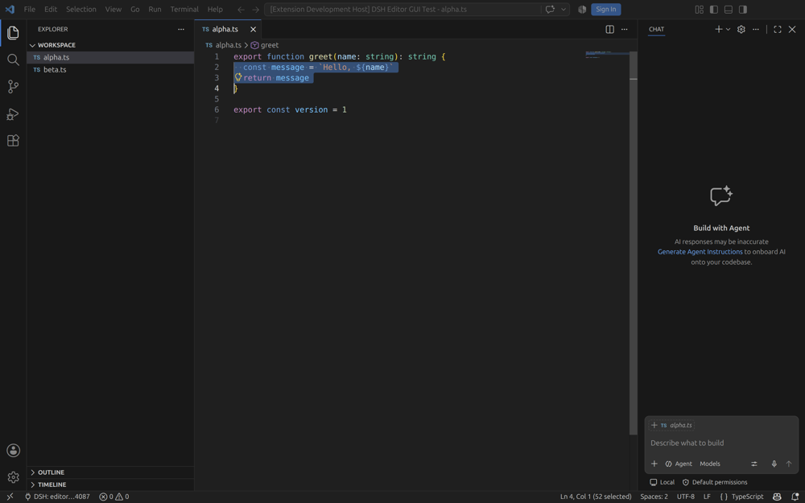

# VS Code ↔ DSH Web GUI 验收

这套流程启动真实 VS Code Extension Development Host 和真实 dsh Web 应用，通过鼠标、键盘和网页控件验证上下文同步。模型端使用录制型适配器，保留真实 AgentLoop、会话日志和输入区，不访问外部模型 API。

## 环境与启动

本次验证环境：Linux / X11，Node.js 26.4.0，VS Code 1.138.0，Chrome 150，dsh 0.2.2-rc.1（源码 `fcc0ad4621`）。需要 `dsh`、`code` 在 PATH 中，以及一个可用的桌面 DISPLAY。Chrome DevTools MCP 负责 Chrome 页面；VS Code 是另一个 Electron 调试目标，由本项目的轻量 CDP 脚本操作。

在两个源码仓库准备好依赖并构建：

```sh
# dsh-editor-socket
npm run build
# vsc-agents-connector
npm run compile
```

socket 仓库可通过 `npm run link:dsh -- /path/to/deepseek-harness` 使用已构建的本地 dsh 依赖。以下 GUI 工具仅供源码 checkout 使用，不属于插件运行时代码。

在 socket 仓库生成独立测试环境：

```sh
node scripts/gui/prepare.mjs /path/to/vsc-agents-connector 9223
```

命令打印 `/tmp/dsh-editor-gui-XXXXXX/run.json`。最后一个参数是空闲的 VS Code 调试端口，可以省略，默认 9223。不要复用另一个正在运行的调试实例的端口。

脚本创建示例 workspace、独立 `DSH_HOME`、独立 `XDG_STATE_HOME`、独立 VS Code user-data 和 extensions 目录，并通过本地链接把 socket 加入临时 Web profile。它不修改原有 dsh profile，不安装到日常 VS Code 配置，也不执行依赖下载。

在两个终端分别启动，`GUI_RUN` 使用上一步打印的路径：

```sh
GUI_RUN=/tmp/dsh-editor-gui-XXXXXX/run.json
node scripts/gui/launch.mjs "$GUI_RUN" dsh
```

```sh
GUI_RUN=/tmp/dsh-editor-gui-XXXXXX/run.json
node scripts/gui/launch.mjs "$GUI_RUN" code
```

dsh 会打印带一次性登录 token 的本机 URL，用 Chrome DevTools 的 `new_page` 打开它，可以指定独立 browser context。不要将这个 URL、注册文件或 token 写进报告或 Git。

测试 fixture 自动创建一条初始化对话。若它没有出现在 workspace 分组中，展开 **Ungrouped**，打开 `GUI context recorder…` 会话。`session.json` 记录当前测试的 session ID；fixture 每次启动生成新 ID，避免与持久化的旧会话冲突。

VS Code 标题应包含 `[Extension Development Host] DSH Editor GUI Test`。若出现首次运行的欢迎／登录提示，关闭提示或选择 **Continue without Signing In**，不需要登录账户。

## 实际交互步骤

可以手动操作 VS Code，也可以使用 CDP 辅助脚本。脚本用 DOM 查找控件位置，再发送真实鼠标／键盘事件；不会直接调用 editor socket API、修改 adapter 内部状态或伪造网页引用条。

```sh
node scripts/gui/vscode.mjs "$GUI_RUN" open alpha.ts
node scripts/gui/vscode.mjs "$GUI_RUN" enter
node scripts/gui/vscode.mjs "$GUI_RUN" command 'VSC Agents: Connect to Local Service'
node scripts/gui/vscode.mjs "$GUI_RUN" enter
```

只有一个候选会话时会直接连接；有多个候选时，根据 `session.json` 选择本次测试会话，再按 Enter。不要无条件发送多余 Enter，它可能落入编辑器或其他控件。

| 操作 | 应看到的结果 |
| --- | --- |
| 打开 `alpha.ts` 并连接 | VS Code 状态栏显示 DSH；dsh 输入区显示 `Following alpha.ts` |
| 从第 2 行开头拖选到第 4 行开头 | 显示 `alpha.ts#L2-3`，不把未选中的第 4 行算进去 |
| VS Code 执行 **Send Selection to Session** | 变为 `Pinned alpha.ts#L2-3`，不产生模型任务 |
| 在 Explorer 点击 `beta.ts` | 同时显示 Following beta 和 Pinned alpha |
| 网页点击 **Clear current reference** | 只移除 Following，Pinned 保留 |
| 网页点击 **Remove reference** | 移除该固定引用；没有引用时整个引用条消失 |
| 网页点击 **Pin reference** | 固定当前引用并移除 Following 状态 |
| 从网页发送消息 | 对应上下文进入模型请求，固定引用被消费一次 |
| VS Code 执行 **Disconnect** | 网页实时引用立即消失 |
| 再次连接同一会话 | 无需改变选区，当前引用立即恢复 |

小文件的鼠标选区与文件点击可以复现为：

```sh
node scripts/gui/vscode.mjs "$GUI_RUN" select 2 4
node scripts/gui/vscode.mjs "$GUI_RUN" command 'VSC Agents: Send Selection to Session'
node scripts/gui/vscode.mjs "$GUI_RUN" enter
node scripts/gui/vscode.mjs "$GUI_RUN" file beta.ts
```

`select` 的参数是可见区域中从 1 开始的起始行与**不包含在范围内的结束行**，适用于 fixture 这种未滚动、没有折叠和换行的小文件。它会失败于找不到可见行的情况；不是通用的代码编辑器自动化接口。

## 会话标题回归

socket 0.1.1 起，`sessions` 从 dsh 的 `title` projection 返回当前标题。
`test/host.test.ts` 覆盖无标题服务、新会话、中文标题、重命名、会话隔离和标题服务卸载；
`scripts/smoke-vscode.mjs` 验证编译后的 VS Code adapter 能取得真实 DSH 标题及后续重命名。
连接器的生命周期测试覆盖标题保存、恢复、切换到无标题会话及长标题提示。

GUI 复查时，在 DSH 重命名会话，再执行 **Connect to Local Service**：候选项应显示新标题，
选中后状态栏应显示相同标题，悬停保留完整标题和会话 ID。状态栏保存的是连接时取得的标题，
目前不订阅重命名事件，需要重新连接刷新。

可复用的标题 GUI 断言脚本为 `scripts/gui/check-title.mjs`。先准备专用 fixture，再按上面的启动步骤
启动 DSH 和 VS Code（替换 `GUI_RUN` 为新生成的路径）：

```sh
node scripts/gui/prepare.mjs /path/to/vsc-agents-connector 9223 --titles
```

`--titles` 创建一条中文标题会话和一个无标题的活动 agent；后者确保连接时出现选择器。
脚本按 `session.json` 中的 ID 查找条目，不依赖候选顺序或总数。关闭首次启动提示后运行：

```sh
node scripts/gui/check-title.mjs "$GUI_RUN"
```

它通过真实鼠标点击状态栏、选中会话并打开悬停提示，断言选择器标题、工作区、连接后的标题和
完整会话 ID。不会调用 adapter 或 socket 接口来代替 UI 操作。

接着在 Chrome 打开 fixture 的 `编辑器标题回归：初始会话`：悬停左侧会话行，点击行内
**Session actions → Rename**（不是会话顶部的 **More actions**），输入下列标题并确认。
然后运行同一脚本验证重新发现与连接：

```sh
GUI_TITLE='重命名 GUI title regression checks status truncation and full hover 🧪'
node scripts/gui/check-title.mjs "$GUI_RUN" "$GUI_TITLE"
```

这个标题超过状态栏的 40 字符显示上限，但在 DSH 默认的 `maxTitleBytes: 80` 内。
脚本检查状态栏缩略、实际悬停提示保留完整标题和 ID。测试期望必须是 DSH **保存后的标题**；
过长的全中文输入会先被 DSH 按 UTF-8 字节截断，不能当作连接器丢失标题。

在测试 VS Code 的命令面板执行 **Developer: Reload Window**，等待窗口完成重载后验证保存的标题，
最后验证切换到无标题会话：

```sh
node scripts/gui/check-title.mjs "$GUI_RUN" "$GUI_TITLE" --restored
node scripts/gui/check-title.mjs "$GUI_RUN" --untitled
```

`--restored` 不发起连接，只检查重载后的状态栏和悬停；`--untitled` 重新打开选择器并选中无标题会话，
检查 ID 回退及旧标题清理。每次检查还会确认录制模型日志没有增加；成功追加 `title-checks.jsonl`，
截图写入 `screenshots/title-<initial|renamed|restored|untitled>-<picker|status>.png`。
断言失败返回非零退出码。脚本是需要真实桌面环境的 GUI 验收项，不放进普通 `npm test`。

本地通过链接安装插件时，构建只更新磁盘文件。若 HMR 的 `root` 为空，代码要等 profile
重新组合或 DSH 重启才生效；不能仅凭构建成功判断正在运行的服务已经更新。
可只读调用 `sessions` 检查返回值，避免为验收改动用户已有会话。

## 历史会话与重启回归

socket 0.1.2 修复了“侧边栏有 6 条会话、连接器只显示已加载的 2 条”的发现范围问题。
新增 `test/sessions.test.ts` 覆盖只读枚举、工作目录过滤、子会话／归档／历史空白占位排除、删除、取消和恢复失败；
连接器的 adapter 测试覆盖 6 条未加载会话的筛选及只向选中会话发起连接。

在两个仓库构建后运行 `npm run test:history`，或直接运行：

```sh
node scripts/smoke-history.mjs ../vsc-agents-connector/out/src/agents/dsh/index.js
```

脚本在独立的临时 Web profile 中创建 6 条同目录会话，以及异目录、归档和空白占位会话各 1 条，正常停止 DSH 后重新启动。
第二次启动通过编译后的 VS Code adapter 访问真实 socket；不先从网页打开历史会话。
2026-11-06 验证结果：

| 检查 | 结果 |
| --- | --- |
| 当前 workspace 的历史候选及标题 | 6 条，全部保留 |
| 枚举后已加载 agent | 0 |
| 拒绝异目录、不存在、归档和历史空白占位目标后已加载 agent | 0 |
| 选中一条历史并连接后已加载 agent | 1 |
| 连接与选区更新期间模型请求 | 0 |
| 显式发送消息 | 1 次请求，包含恢复后的选区内容 |

临时 profile 的真实 SessionController、JSONL 存储和投影缓存参与此测试；没有伪造会话列表或恢复接口。
模型使用本地录制适配器。脚本成功后清理目录；失败时保留私有诊断文件，其日志可能含测试登录令牌，不应提交。

GUI 复查时，重启测试 DSH 后先直接打开 VS Code 连接列表，确认历史候选仍在；不要先逐条点击网页会话，
否则会把历史恢复为已加载状态，掩盖这一回归。此项自动化验证的是进程、存储、socket 和编译后的 adapter；
选择器与状态栏本身的 GUI 断言见上一节。

DSH 侧边栏还有独立的展示条数限制：每组默认只显示前 5 条非空白会话，可通过 **Show more** 展开，
当前会话等状态也可能自动提高显示条数。连接器列出全部符合条件的候选，不照搬侧边栏的分页上限；
因此候选总数可以多于侧边栏当前可见行数。

## 验证未保存文本与发送时机

1. 在 VS Code 打开 `beta.ts`。
2. 执行下面的 `unsaved` 动作，替换编辑器内容并全选；不要保存文件。
3. 在网页点击 **Pin reference**。
4. 在 dsh 输入区输入以 `GUI_TEST_SEND:` 开头的消息，然后点击真实 **Send message** 按钮。
5. 运行录制检查。

```sh
node scripts/gui/vscode.mjs "$GUI_RUN" unsaved
# 完成上面的网页固定、输入和发送操作后：
node scripts/gui/check-recording.mjs "$GUI_RUN"
```

通过时输出包含 `unsavedSelectionCaptured: true` 和 `diskUnchanged: true`。脚本确认模型收到的 `editor-socket` 用户上下文含 `GUI_UNSAVED_MARKER`，且磁盘上的 `beta.ts` 没有该标记。仅看到网页 chip 不足以证明文本进入了模型请求。

`model-requests.jsonl` 记录录制适配器收到的用户消息。初始化和自动标题生成也可能调用适配器：先等初始化完成，记录请求数基线，再做点击、划选和 pin。它们不应增加请求数；用户通过网页发送消息后才增加。本次基线为 2，完成全部前置编辑操作后仍为 2，网页发送后为 3。

## 网页检查与截图

Chrome DevTools 使用 `take_snapshot` 获取当前 uid，再执行 `click` / `fill`。切换会话或组件重载后重新取 snapshot，不复用已经失效的 uid。`evaluate_script` 用来读取状态和布局；验收操作本身通过实际控件完成。

布局检查需要真实浏览器。读取 `section[aria-label="Editor context"]` 和输入卡片的 `getBoundingClientRect()`，确认左右边界一致；再用 `resize_page` 检查窄窗口和横向溢出。语言切换后应使用相应的 aria-label。

截图保存到 run 目录的 `screenshots/`，VS Code 截图可用：

```sh
node scripts/gui/vscode.mjs "$GUI_RUN" screenshot
```

最后检查 Chrome `list_console_messages`，以及 VS Code user-data 目录的 `logs/*/window*/exthost/exthost.log`。区分扩展错误与 VS Code 自身的更新、登录或废弃 API 提示；不要把所有 stderr 都归因于连接器。

## 2026-11-06 验收记录

以上核心交互均已在真实界面执行通过，包括：实际拖选、两端固定操作、文件切换、清除／移除、未保存文本、网页发送、一次性消费、断开与重连。网页控制台未出现 error / warn。

标题补充回归也已通过：`initial`、`renamed`、`restored`、`untitled` 四项 GUI 检查，覆盖中文、
中英文与 emoji 长标题、网页重命名后重连、真实窗口重载恢复、无标题回退和完整悬停提示。
模型请求数从初始化到测试结束保持 2 次；Chrome 控制台无 error / warn。

长标题的状态栏缩略与完整悬停（实际界面裁剪）：



本次发现并修复了一个仅渲染单元测试无法发现的布局问题：`conversation.input.dock` 位于 InputBar 的居中容器之外，原引用条占满会话栏宽度，贴在左侧。修复后引用条使用宿主的 `--dsh-composer-card-max-width` 和 `--dsh-composer-side-clearance`，跟随输入框的宽度设置。

| 视口宽度 | 引用条 x / width | 输入卡片 x / width | 横向溢出 |
| --- | --- | --- | --- |
| 1280 | 420.5 / 712 | 420.5 / 712 | 无 |
| 640 | 16 / 601 | 16 / 601 | 无 |

修复前（引用区裁剪）：


修复后，宽窗口：



修复后，窄窗口：



实际 VS Code 拖选（缩小截图）：



## 复现经验与边界

- 先设置临时 `DSH_HOME`，再运行 dsh，包括 `--help`：launcher 也可能初始化 profile 文件。
- DSH 与 VS Code 必须使用同一个临时 `XDG_STATE_HOME`，否则扩展可能找不到测试 socket，或发现日常运行的其他实例。
- 一个空 Agent 不等于一个容易从网页列表打开的对话。先初始化一条消息，再从界面选中对应会话。
- 重启 fixture 时不要固定使用已存在的 Session ID；持久化服务会报 `SessionAlreadyExistsError`。
- VS Code 会将 `--remote-debugging-port` 转交 Electron，CLI 的 unknown-option 提示本身不表示启动失败。实际检查 `/json/list` 中是否有测试窗口。
- 首次运行的欢迎弹窗会拦截快捷键，Enter 也可能只是关闭弹窗。辅助脚本会等待命令面板出现；超时应先处理弹窗，再重新打开文件，不能把一次按键当作操作成功。
- Electron 窗口在后台时，鼠标事件可能只获得焦点。脚本在输入前执行 `Page.bringToFront`；拖选后仍要核对 VS Code 状态栏的 selected 字符数和网页引用行号。
- VS Code 的自动缩进会改变 `Input.insertText` 后的空白与末行列号。生成配置关闭自动缩进；断言应以真实选区和录制内容为准。
- CDP 辅助工具只支持已验证的 VS Code DOM 和可见小文件。界面升级后应检查实际标签和节点，不能把位置选择器猜测当作测试结果。
- 验收覆盖 Linux VS Code + DSH **Web**，没有验证 DSH Desktop、Remote SSH、其他操作系统、真实模型提供方或断网恢复。排队快照与插件重载恢复另有自动化测试。

结束后关闭测试 VS Code 窗口，对示例文件选择不保存；停止临时 dsh 进程，再按需删除该 run 目录。不要删除日常配置或终止不属于本次测试的窗口。测试登录 token、socket 注册文件、完整运行目录和原始调试日志都不要提交。
